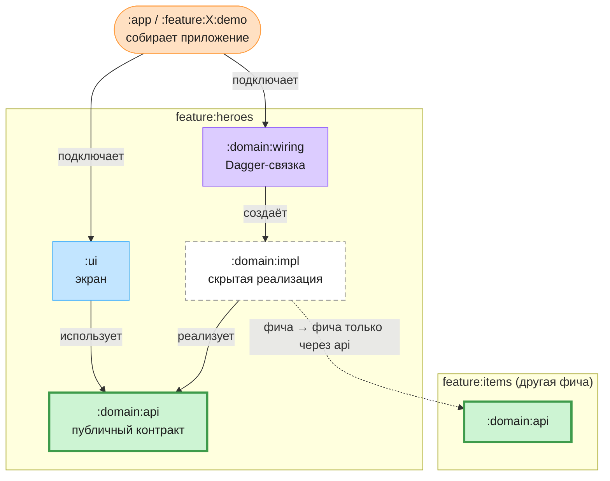
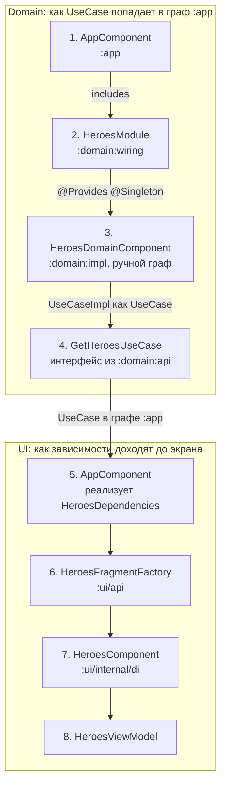
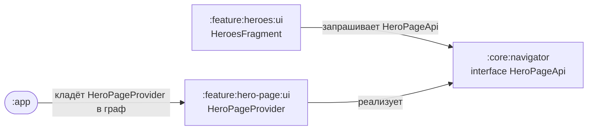
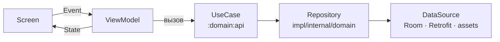
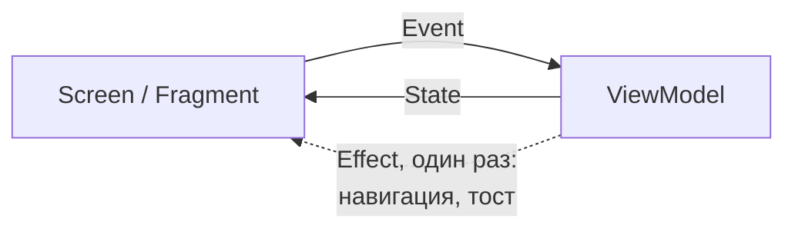

# About Dota 2
![Downloads badge][downloads badge]  ![Ratings badge][ratings badge]

All you want to know about dota in one app

[](https://play.google.com/store/apps/details?id=n7.ad2)

## Tech-stack


* Tech-stack
    * [Kotlin](https://kotlinlang.org/) + [Coroutines](https://kotlinlang.org/docs/reference/coroutines-overview.html)
    * [Dagger2](https://dagger.dev/)
    * [Compose](https://developer.android.com/jetpack/compose)
    * [Room](https://developer.android.com/topic/libraries/architecture/room)
* Testing
    * [Unit Tests](https://en.wikipedia.org/wiki/Unit_testing) ([JUnit 4](https://junit.org/junit4/)
    * [UT Tests](https://en.wikipedia.org/wiki/Graphical_user_interface_testing) ([Espresso](https://developer.android.com/training/testing/espresso))
    * [Truth](https://truth.dev/)

## Архитектура

> Раздел описывает **целевую** архитектуру. Часть фич ещё переезжает на неё — новые изменения делаем по этим правилам.

Основные принципы:

- **Одна сущность — одна ответственность.** Фича разбита на модули, у каждого модуля своя роль.
- **`:domain:api` — единственное, что фича показывает наружу.** Всё остальное `internal`.
- **Зависимости идут в одну сторону.** На одном уровне модули друг о друге не знают.

Как читать диаграммы: стрелка `A → B` значит «A зависит от B».
Цвета: 🟧 app · 🟦 ui · 🟩 api · ⬜ impl · 🟪 wiring.

### 1. Как устроена фича



| Модуль | Ответственность | Зависит от |
|---|---|---|
| `:feature:X:ui` | Экран: отрисовка, ViewModel, маппинг Model → VO | `:feature:X:domain:api`, `:core:ui`, `:core:navigator` |
| `:feature:X:domain:api` | Публичный контракт: интерфейсы UseCase, модели, ошибки. Чистый Kotlin | только JVM-core |
| `:feature:X:domain:impl` | Реализация UseCase, репозитории, работа с данными. Всё `internal` | `:feature:X:domain:api`, data-core |
| `:feature:X:domain:wiring` | Dagger-модуль: создаёт impl и отдаёт UseCase в граф `:app` | `:feature:X:domain:impl`, `:core:dagger` |
| `:feature:X:demo` | Отдельное приложение для разработки одной фичи | `ui` + `wiring` своей фичи |
| `:app` | Собирает приложение из фич | `ui` + `wiring` всех фич |
| `:core:*` | Общие утилиты, ничего не знают про фичи | другие `:core:*` |

### 2. Что лежит внутри каждого модуля

```
feature/heroes/
├── ui/                                  :feature:heroes:ui
│   ├── api/                             ← видно снаружи
│   │   ├── HeroesDependencies           что фиче нужно от :app
│   │   ├── HeroesFragmentFactory        создаёт Fragment с зависимостями
│   │   └── HeroesProvider               точка входа для навигации (реализует HeroesApi)
│   └── internal/
│       ├── screen/                      HeroesFragment / HeroesScreen, HeroesViewModel
│       ├── model/                       HeroesState, HeroesEvent, HeroesEffect, VOHero, HeroVOMapper
│       └── di/                          HeroesComponent — DI экрана
├── domain/
│   ├── api/                             :feature:heroes:domain:api (kotlin-jvm)
│   │   ├── usecase/                     GetHeroesUseCase — interface
│   │   ├── model/                       Hero, HeroDescription
│   │   ├── error/                       HeroesError — sealed
│   │   └── testFixtures/                FakeGetHeroesUseCase — фейки для других модулей
│   ├── impl/                            :feature:heroes:domain:impl
│   │   ├── di/                          HeroesDomainDependencies, HeroesDomainComponent (ручной граф)
│   │   └── internal/
│   │       ├── domain/                  GetHeroesUseCaseImpl, HeroesRepository — interface
│   │       └── data/                    HeroesRepositoryImpl, HeroesLocalDataSource, HeroesRemoteDataSource,
│   │                                    HeroEntity, HeroDto, HeroEntityMapper, HeroDtoMapper
│   └── wiring/                          HeroesModule
└── demo/                                DemoApplication, DemoComponent
```

### 3. Как собирается DI



- Dagger есть только в `:app`, `:domain:wiring` и `ui/internal/di`. В `:domain:api` и `:domain:impl` Dagger нет: impl собирает свой граф вручную в `DomainComponent`.
- `DomainComponent` создаётся **один раз на фичу** (`@Singleton` на `@Provides`). UI-компонент живёт столько же, сколько экран.
- Всё, что нужно фиче снаружи, перечислено явно: `HeroesDomainDependencies` (для impl) и `HeroesDependencies` (для ui).

### 4. Навигация и связи между фичами



UI-модули разных фич друг о друге не знают. Экран открывает другую фичу через интерфейс из `:core:navigator`, а реализацию подставляет `:app`.

| Связь | Можно? | Зачем |
|---|---|---|
| `A:ui → B:domain:api` | ✅ | экран показывает данные другой фичи |
| `A:domain:impl → B:domain:api` | ✅ | логика опирается на другую фичу |
| `A:ui → B:ui` | ❌ | только через `:core:navigator` |
| `A:domain:impl → B:domain:impl` | ❌ | только через api |
| `A:impl → B:api` **и** `B:impl → A:api` | ❌ | логический цикл: общее выносим в отдельную фичу или core |

**Общие данные** (герои, предметы) принадлежат фиче-владельцу. Остальные фичи читают их через её `:domain:api`.

### 5. Данные, модели, ошибки и потоки



| | data (`impl/internal/data`) | domain (`api` + `impl/internal/domain`) | ui (`ui/internal`) |
|---|---|---|---|
| **Модели** | `HeroEntity`, `HeroDto` | `Hero` | `VOHero`, `HeroesState` |
| **Маппинг** | `HeroEntityMapper`, `HeroDtoMapper` → Model | — | `HeroVOMapper`: Model → VO |
| **Ошибки** | исключения Room / Retrofit / IO | `HeroesError` — sealed, объявлен в api | `HeroesState.Error` — текст для пользователя |
| **Потоки** | `Dispatchers.IO` — только здесь | граница слоя: `suspend` / `Flow` | Main: ui собирает `Flow` |

Каждый слой отдаёт наружу только свои модели: Entity и Dto не выходят из impl, VO не выходит из ui.

### 6. Правила зависимостей

**Какой core доступен каждому типу модуля:**

| Модуль | Можно подключать |
|---|---|
| `:domain:api` | `:core:common-jvm`, `:core:coroutines` (только `Flow`) |
| `:domain:impl` | то же + `:core:database`, `:core:retrofit`, `:core:logger`, `:core:common-android` |
| `:ui` | `:core:ui`, `:core:navigator`, `:core:logger`, `:core:coroutines`, `:core:common-android` |
| `:domain:wiring` | `:core:dagger` + impl своей фичи |
| `:app`, `:demo` | всё |

**Запрещено всегда:**

- Android SDK и Dagger в `:domain:api`;
- Dagger в `:domain:impl`;
- `:ui` → `:domain:impl`, `:core:database`, `:core:repositories`;
- `:core:*` → `:feature:*`;
- бизнес-логика в `:ui` (там только отображение и маппинг Model → VO).

### 7. UI-слой и тесты



| Где | Что тестируем | Чем подменяем зависимости |
|---|---|---|
| `domain:api/testFixtures` | — | здесь лежат фейки UseCase для всех |
| `domain:impl/test` | UseCaseImpl, Repository, мапперы | фейковые DataSource |
| `ui/test` | ViewModel: Event → State | фейки из `domain:api/testFixtures` |
| `ui/androidTest` | экран | фейки из `domain:api/testFixtures` |
| `:demo` | фича целиком, вручную | реальный impl |

### 8. Словарь имён

| Суффикс | Модуль / пакет | Пример |
|---|---|---|
| `*UseCase` | `domain:api/usecase` — interface | `GetHeroesUseCase` |
| `*UseCaseImpl` | `domain:impl/internal/domain` | `GetHeroesUseCaseImpl` |
| `*Repository` / `*RepositoryImpl` | `impl/internal/domain` / `impl/internal/data` | `HeroesRepository` |
| `*DataSource` | `impl/internal/data` | `HeroesLocalDataSource` |
| `*Entity` / `*Dto` | `impl/internal/data` | `HeroEntity`, `HeroDto` |
| `*Mapper` | там, где модель превращается в модель следующего слоя | `HeroEntityMapper`, `HeroVOMapper` |
| `*Error` | `domain:api/error` | `HeroesError` |
| `VO*` | `ui/internal/model` | `VOHero` |
| `*State` / `*Event` / `*Effect` | `ui/internal/model` | `HeroesState` |
| `*DomainDependencies` / `*DomainComponent` | `domain:impl/di` | `HeroesDomainComponent` |
| `*Dependencies` / `*FragmentFactory` / `*Provider` | `ui/api` | `HeroesDependencies` |
| `*Component` | `ui/internal/di` | `HeroesComponent` |
| `*Module` | `domain:wiring` | `HeroesModule` |
| `Fake*` | `domain:api/testFixtures` | `FakeGetHeroesUseCase` |

## Directory structure

    ├── app                # Mobile app
    ├── build-logic        # Kotlin DSL scripts for project
    ├── features
    │   ├── drawer         # Main screen with draggable view where place all other features
    │   ├── games          # Mini games that relate to dota2
    │   ├── hero-page      # Page with information of selected hero
    │   ├── heroes         # List with all available hero
    │   ├── item-page      # Page with information of selected item
    │   ├── items          # List with all available items
    │   ├── news           # Latest news about dota2
    │   ├── settings       # Application settings for user
    │   ├── streams        # List with live streams from Twitch.tv
    │   └── tournaments    # List with future dota2 tournaments 
    ├── core
    │   ├── common         # Shared Kotlin code
    │   ├── android        # Shared Android code
    │   ├── database       # Application database
    │   ├── app-preference # Application Preferences
    │   ├── coroutines     # Coroutines
    │   ├── dagger         # Dagger
    │   ├── media-player   # MediaPlayer
    │   ├── retrofit       # Retrofit
    │   ├── media-player   # MediaPlayer 
    │   ├── update-manager # Google In-app-update
    │   ├── ktx            # Extensions for android modules
    │   ├── logger         # Custom logger for app
    │   ├── navigator      # Module that allows feature modules communicate with other feature modules without direct dependency
    │   ├── repositories   # All repositories
    │   ├── rules          # Custom lint rules for project
    │   ├── span-parser    # Custom html->Spannable library to simpilify using spans in prepared text
    │   ├── ui             # Common UI elements for all features
    │   └── parser         # Hero/Items/Response parser that creates .json files for the app

## Development Tools

## Getting started with Android Studio

1. `Android Studio` -> `File` -> `New` -> `From Version control` -> `Git`
2. Enter `https://github.com/i30mb1/AD2.git` into URL field an press `Clone` button
3. (Optional) Configure selective module inclusion in `local.properties` for faster development


### Selective Module Inclusion
For faster development in this large multi-module project, use the [IncludeModulesPlugin](docs/include-modules-plugin.md) to include only the modules you need:

```properties
# local.properties
module=":feature:games:xo:demo"  # Include only XO game demo + dependencies (16 modules vs 62)
module=":app"                    # Include only app + dependencies (43 modules vs 62) 
module=""                        # Include all modules (default behavior)
```

This can reduce sync and build time by up to 74%! See [full documentation](docs/include-modules-plugin.md) for details.

[downloads badge]: https://PlayBadges.pavi2410.me/badge/downloads?id=n7.ad2
[ratings badge]: https://PlayBadges.pavi2410.me/badge/ratings?id=n7.ad2
